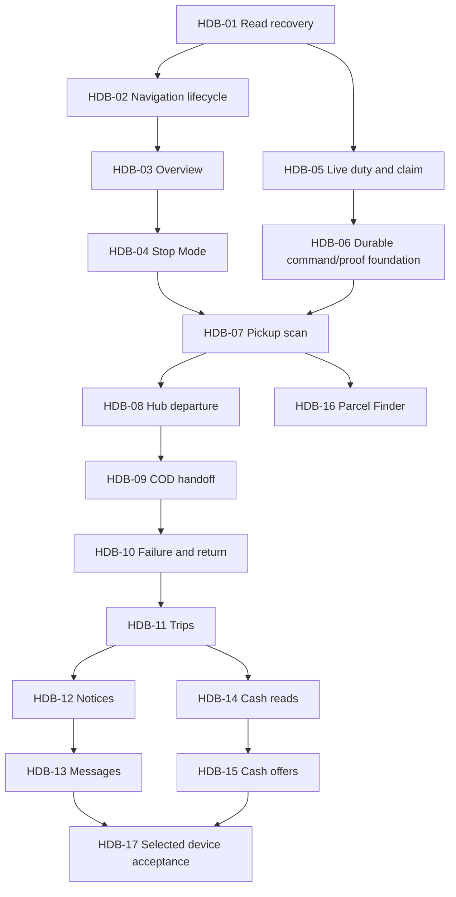

# Home implementation branch sequence

This is a dependency-aware delivery plan, not authorization to execute every
row now. Select one HDB ID per prompt. Current review/source and gates are in
[README](README.md), [REVIEW](REVIEW.md) and the
[API checklist](../../api/HOME_DASHBOARD_NEEDS.md).

## Recommended order

| ID / brief | Branch | Concrete result | Required HDB predecessors | Client effort | State |
|---|---|---|---|---|---|
| [HDB-01](01-home-read-recovery.md) | `fix/home-read-recovery` | Recover reads and remove newly hidden tasks | Current foundation | 4–7 h | Merged; local checks verified |
| [HDB-02](02-home-navigation-lifecycle.md) | `fix/home-navigation-lifecycle` | Stop ended location streams and bound hidden map work | HDB-01 | 4–7 h | Merged in PR 18; local checks verified |
| [HDB-03](03-home-dashboard-overview.md) | `feat/home-dashboard-overview` | Make the Home overview useful with existing server data | HDB-01, HDB-02 | 6 h selected | Merged in PR 20; [evidence](HDB-03-EVIDENCE.md) |
| [HDB-04](04-home-stop-mode-guidance.md) | `feat/home-stop-mode-guidance` | Add focused Stop Mode and current-stop guidance | HDB-03 | 6 h selected | Locally verified; review/publication pending; [evidence](HDB-04-EVIDENCE.md) |
| [HDB-05](05-home-duty-claim-acceptance.md) | `feat/home-duty-claim-acceptance` | Accept one live duty and pickup-claim workflow | HDB-01 | 3–6 h | Native live checks passed; website confirmation pending |
| [HDB-06](06-rider-shared-command-intents.md) | `feat/rider-shared-command-intents` | Extend durable command/proof foundation for later actions | HDB-05 | 6–10 h | Planned |
| [HDB-07](07-pickup-waybill-collection.md) | `feat/pickup-waybill-collection` | Scan and confirm seller collection, then await hub intake | HDB-04, HDB-06 | 6–10 h | Planned |
| [HDB-08](08-final-mile-scanned-departure.md) | `feat/final-mile-scanned-departure` | Scan a hub-assigned parcel out for delivery | HDB-04, HDB-06, HDB-07 | 4–7 h | Planned |
| [HDB-09](09-final-mile-cod-handoff.md) | `feat/final-mile-cod-handoff` | Record genuine proof, recipient and exact COD delivery | HDB-06, HDB-08 | 7–12 h | Planned |
| [HDB-10](10-failed-delivery-return-guidance.md) | `feat/failed-delivery-return-guidance` | Record one failed attempt and show hub-owned recovery | HDB-06, HDB-08, HDB-09 | 5–8 h | Planned |
| [HDB-11](11-trips-retained-history.md) | `feat/trips-retained-history` | Connect real Trips, protected evidence and recent Home work | HDB-06, HDB-09, HDB-10 | 5–9 h | Planned |
| [HDB-12](12-home-durable-notices.md) | `feat/home-durable-notices` | Add a real Home inbox and exact notice read state | HDB-03, HDB-06, HDB-11 | 4–7 h | Planned |
| [HDB-13](13-rider-assignment-messages.md) | `feat/rider-assignment-messages` | Connect phase-bound Messages and the current-stop shortcut | HDB-04, HDB-06, HDB-12 | 6–10 h | Planned |
| [HDB-14](14-home-cash-responsibilities.md) | `feat/home-cash-responsibilities` | Add exact cash responsibility and recorded receipt views | HDB-03, HDB-06, HDB-11 | 4–7 h | Planned |
| [HDB-15](15-rider-cash-remittance-offers.md) | `feat/rider-cash-remittance-offers` | Submit a remittance offer without claiming recipient receipt | HDB-06, HDB-14 | 4–7 h | Planned |
| [HDB-16](16-rider-parcel-finder.md) | `feat/rider-parcel-finder` | Add selected personal parcel-slot labels | HDB-04, HDB-07 | 3–5 h | Planned |
| [HDB-17](17-rider-home-device-acceptance.md) | `test/rider-home-device-acceptance` | Accept the complete selected Home workflow on real devices | HDB-01, HDB-02, HDB-03, HDB-04, HDB-05, HDB-06, HDB-07, HDB-08, HDB-09, HDB-10, HDB-11, HDB-12, HDB-13, HDB-14, HDB-15 | 6–10 h | Planned |

HDB-01 and HDB-02 address confirmed defects first. HDB-03/04 make existing
information usable. HDB-05 can follow HDB-01 as soon as its external gate is
available; it does not need to wait for every visual enhancement. HDB-06 precedes
later write consumers because the current journal accepts only duty and claim.

HDB-07–10 cover ordinary physical pickup/final-mile outcomes. HDB-11 connects
actual retained history. HDB-12/13 add notices and communication; HDB-14/15 add
cash visibility and offer-only remittance. HDB-16 is the selected personal Parcel
Finder addition with a proposed session-only first scope. It may follow its
actual prerequisites, and is not required to certify unrelated payment commands.

HDB-17 accepts the complete selected run. For the full sequence its listed core
predecessors must be accepted; if the user deliberately selects a smaller run,
record that decision and its exact acceptance scope rather than marking omitted
features complete. No API/deployment/device blocker changes into a success because
another branch was green.

## Dependency view

The diagram summarizes sequence; individual briefs and the canonical backlog
carry every direct/transitive prerequisite and external gate. Source dependency
is different from deployment, test data, physical camera/GPS and owner policy.
The [prerequisite audit](PREREQUISITES.md) derives the full canonical closure and
explains partial coverage versus full-card completion, including deferred native
release/recovery/earnings and later cross-feature verification.

## Capacity and scope decisions

Total planning range is **80–137 client hours**. It overlaps existing backlog
estimates, excludes backend changes/merge waiting and assumes one mobile owner.
Do not promise completion by November 20 without checking actual capacity and
external readiness. Re-estimate one selected branch, use a bounded 1–14-day
window and preserve the November 21 presentation assumption.

Prioritize defect/read recovery, useful current-stop UI and accepted ordinary
pickup/final-mile work before optional analytics or server extensions. Delivered
Today/chart metrics, richer seller/hub instructions/coordinates, non-COD handoff,
release/restricted recovery and earnings require their separately chosen backend
contracts. They are not quietly folded into these mobile branches.

Some briefs cover subsets of wider backlog cards. In particular, supported
failure/return guidance is not native restricted recovery, cash views/offers are
not earnings, and device review is not app identity/signing/freeze. Update only
verified coverage; creating this sequence never marks all M04–M16 done.

## Review/publication loop

Use [WORKFLOW.md](WORKFLOW.md): current branch implementation and review,
coherent local commits, user push and PR merge, pull updated main, then create
only the next chosen branch. Copyable prompts are supplied separately from Git.
